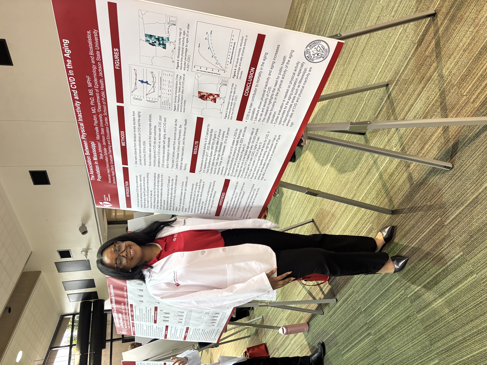
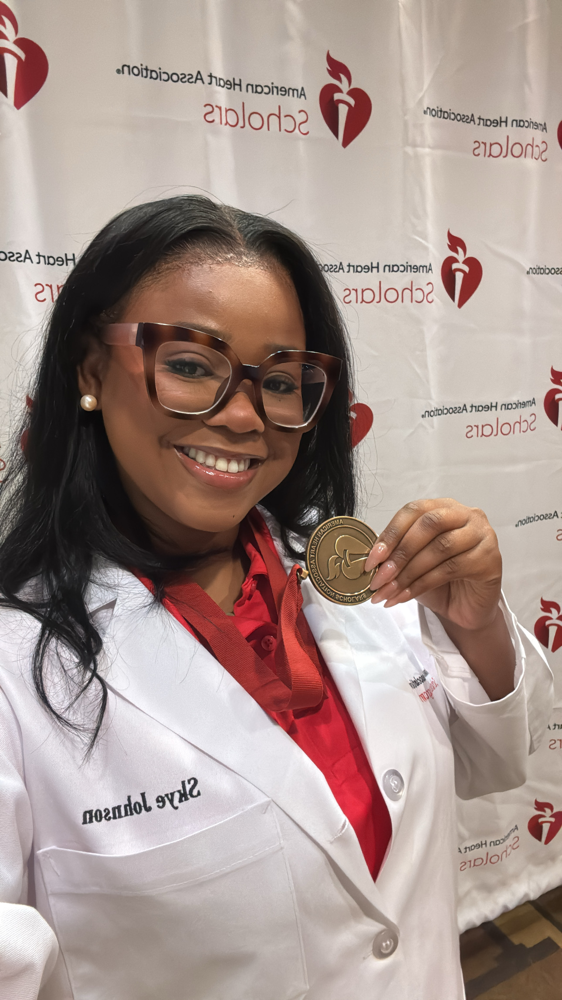
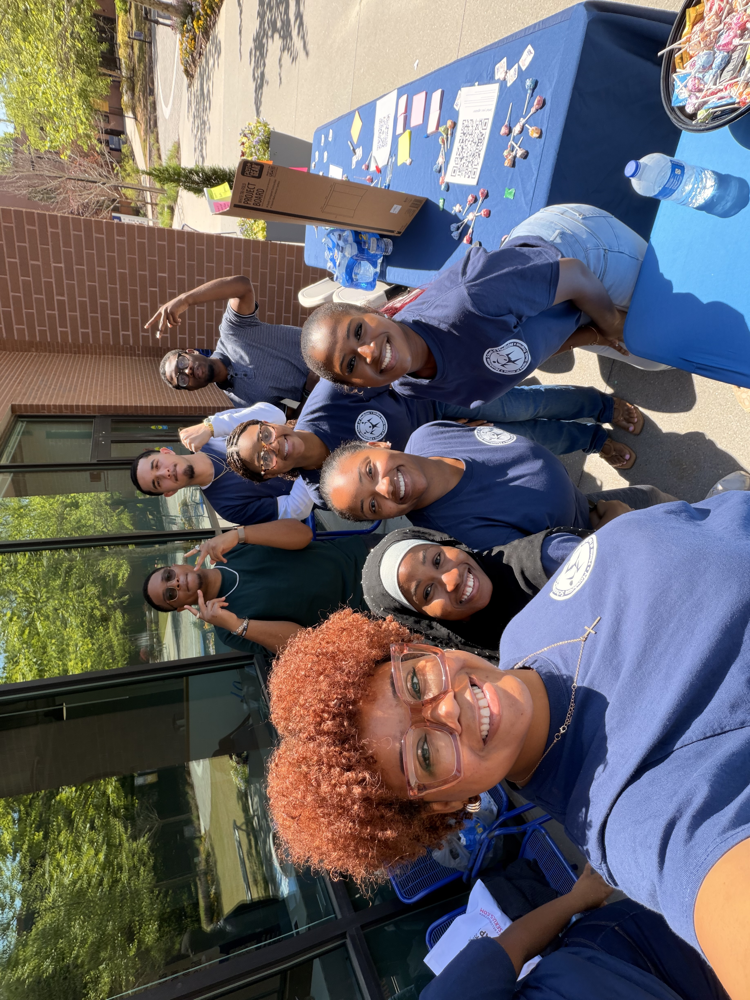
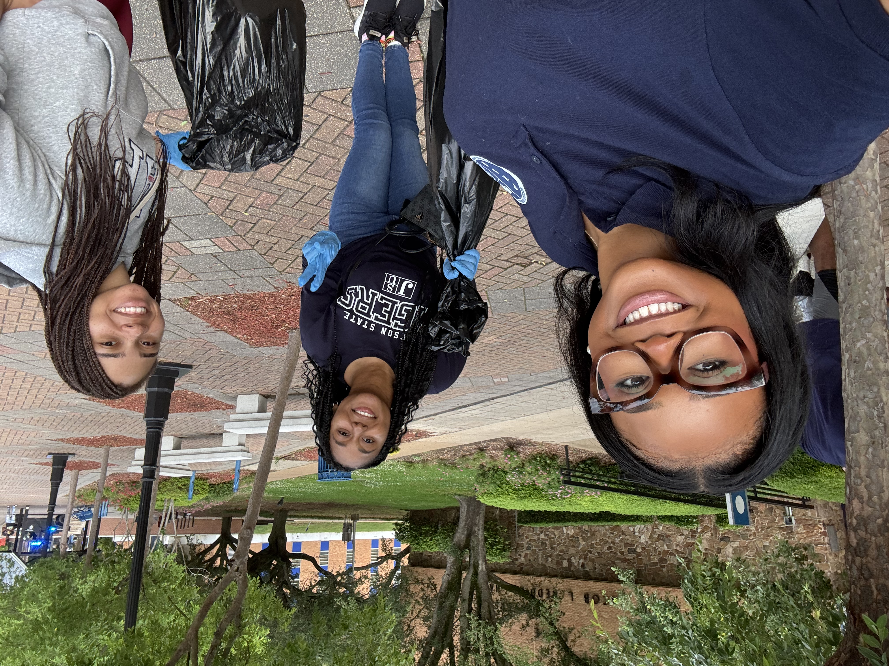

## Public Health Data & Research Intern

*Wellness Equity Alliance, Scotts Valley, CA: May 2026 – August 2026*

-   Conducted a Geographic Information System (GIS) spatial analysis in R by merging HIV prevalence, Social Vulnerability Index (SVI), and county-level geographic data to identify patterns in disease burden and healthcare access across Arizona.

-   Developed an HIV Clinical Quality Measure analysis by integrating appointment and laboratory data, calculating screening rates, benchmarking performance against national measures, and translating findings into data- driven recommendations for public health practice.

## Program Development & Research Intern

*Magnolia Medical Foundation, Jackson, MS: January 2025 - May 2025*

-   Designed and piloted the Laundry Services Project, a public health intervention to mitigate health inequities linked to hygiene insecurity among unhoused and low-income communities.

-   Contributed to cross-functional health equity initiatives, including a clinic inventory proposal and an educational presentation on stress and cardiovascular health, to further understand how social determinants impact chronic disease outcomes

## Cardiovascular Research Scholar

*American Heart Association: August 2024 – May 2025*

-   Partnered weekly with a research mentor to design and execute a quantitative study addressing cardiovascular disease risk factors.

-   Presented observational research at both the American Heart Association Scientific Sessions and the Annual Research Symposium, showcasing findings to professional and academic audiences.

    {alt="Inaugural Women to Graduate from JSU with a BsPH" fig-alt="Photo of Skye Johnson, an African American women presenting a research poster at the American Heart Association Research Conference." fig-align="left" width="250"}

{alt="Inaugural Women to Graduate from JSU with a BsPH" fig-alt="Photo of Skye Johnson, an African American in a white coat and holding a medal from the American Heart Association Research program." fig-align="right" width="250"}

## Dental Reception Assistant

*Dr. William R. Berry III, Albany, GA: May 2021 - January 2024*

-   Welcomed over 40 patients a day and answered all incoming questions about dental treatment.

-   Navigated charting for new and returning patients at least 3 days in advance to minimize patient wait time.

-   Collaborated with other receptionists to research patients’ eligibility for dental treatment through Georgia Insurance companies.

# Leadership Experience

## **Community Outreach Chair** 

**MSM MPH Student Government Association: August 2025 - Present**

-   Serve as an assistant in the organization, implementation, and promotion of service activities and hands-on community engagement in the MPH program.

    {alt="Inaugural Women to Graduate from JSU with a BsPH" fig-alt="Photo of Skye Johnson with 6 others facilitating a sexual health awareness community engagement event." fig-align="center" width="300"}

## **Election Committee Representative** 

**MSM Student Government Association: March 2026 – May 2026**

-   Served as MPH liaison for the SGA board elections, supporting election planning and coordination of a fair and organized electoral process.

## **Chair Member, Hearing Loss & Literacy Symposium**

**Jackson State University: February 2024 – August 2024**

-   Served as a committee liaison and program manager for the book discussion and community service activity for the symposium.

## **President, Bachelor of Science in Public Health Student Association**

**Jackson State University: August 2023 – May 2025**

-   Served as program liaison and facilitator in event organization aimed at educating college students on public health challenges.

    {alt="Inaugural Women to Graduate from JSU with a BsPH" fig-alt="Photo of Skye Johnson, an African American women and 2 others participating in picking up trash around the Jackson State University campus." fig-align="center" width="250"}

## 

